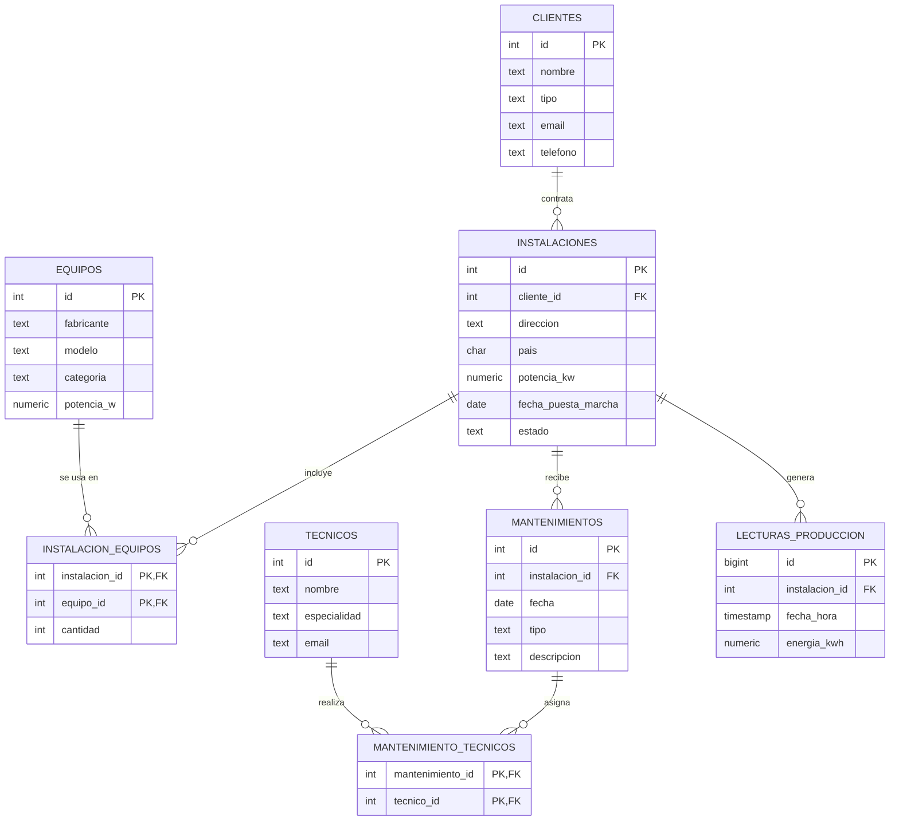

# Base de datos de instalaciones solares

Base de datos en PostgreSQL para gestionar los proyectos de una empresa instaladora de energía solar y aerotermia: clientes, instalaciones, equipos, mantenimientos y producción de energía.

## Diagrama entidad-relación

