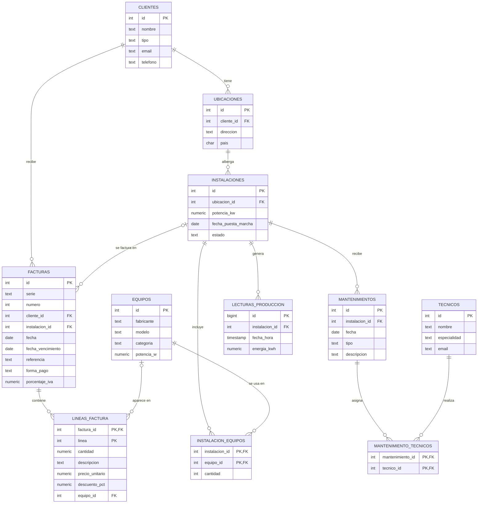

# Base de datos de instalaciones solares

Base de datos en PostgreSQL para gestionar los proyectos de una empresa instaladora de energía solar, aerotermia y climatización que trabaja en España y Francia: clientes, ubicaciones, instalaciones, equipos, mantenimientos, producción de energía y facturación.

El diseño se basa en la actividad real del sector, y la estructura de facturación reproduce el formato de una factura real (con datos de ejemplo ficticios).

## Cómo ejecutarlo

```bash
createdb abk_solar
psql -d abk_solar -f 01_schema.sql        # Tablas y claves
psql -d abk_solar -f 02_seed.sql          # Datos de ejemplo (~43.800 lecturas)
psql -d abk_solar -f 03_integrity.sql     # Restricciones y roles
psql -d abk_solar -f 04_performance.sql   # Índices, mantenimiento y monitorización
psql -d abk_solar -f 05_normalization.sql # Migración: tabla de ubicaciones
psql -d abk_solar -f 06_facturas.sql      # Migración: facturas y líneas
```

## Diagrama entidad-relación



## Decisiones de diseño

- **Las tecnologías van en los equipos, no en la instalación.** Una misma instalación puede combinar placas fotovoltaicas y una bomba de calor sin duplicar registros.
- **Normalización de direcciones.** En el diseño inicial, una casa con dos instalaciones repetía su dirección. La migración `05_normalization.sql` la mueve a la tabla `ubicaciones` dentro de una transacción, para que cada dato viva en un solo sitio y no pueda contradecirse.
- **El precio se guarda en cada línea de factura.** No se toma del catálogo, porque una factura emitida debe conservar el precio del día aunque el catálogo cambie.
- **Los totales se calculan con vistas.** `v_facturas_totales` calcula bruto, IVA y total a partir de las líneas, de modo que nunca pueden quedar desincronizados. Cada factura guarda su porcentaje de IVA para que un cambio futuro del tipo no altere las facturas antiguas. Cada línea se redondea antes de sumar, igual que en la factura real.

## Integridad

- Restricciones `CHECK` para los valores permitidos (tipos de cliente, estados, categorías, formas de pago) y para valores imposibles (potencias negativas, vencimientos anteriores a la fecha de la factura).
- Restricciones `UNIQUE` para emails, modelos de equipo, numeración de facturas por serie y lecturas duplicadas.
- `ON DELETE CASCADE` solo en las lecturas de producción. En el resto, PostgreSQL impide borrar un registro que tiene datos dependientes.
- **Roles según el principio de mínimo privilegio, alineados con el RGPD:**
  - `analista`: solo lectura de todas las tablas.
  - `tecnico`: ve instalaciones, ubicaciones y equipos, y registra mantenimientos, pero no tiene acceso a los datos personales de los clientes ni a la facturación.

## Rendimiento

Consulta de prueba: producción total de todas las instalaciones el 21 de junio de 2025, sobre 43.800 lecturas horarias.

| Situación | Plan de ejecución | Bloques leídos | Tiempo |
|---|---|---|---|
| Sin índices | Seq Scan: lee 43.800 filas y descarta 43.680 | 323 | 8,84 ms |
| Con índice | Index Scan: accede directamente a las 120 filas | 23 | 0,23 ms |

Resultado: unas **40 veces más rápida** con el índice.

Lecciones aprendidas:

- El índice creado automáticamente por `UNIQUE (instalacion_id, fecha_hora)` ya servía para filtrar solo por fecha gracias al *skip scan* de PostgreSQL 18.
- Se creó un índice adicional solo por fecha, pero `EXPLAIN ANALYZE` mostró que el planificador no lo usaba. Se eliminó, porque un índice sin uso ocupa espacio y ralentiza las inserciones.
- PostgreSQL no indexa automáticamente las claves foráneas, así que `04_performance.sql` añade índices en todas las que se usan en `JOIN`.

## Mantenimiento y monitorización

`04_performance.sql` incluye `VACUUM ANALYZE` y consultas sobre `pg_stat_user_tables` y `pg_stat_user_indexes` para vigilar el tamaño de las tablas, detectar índices que no se usan y comprobar las filas muertas pendientes de limpieza.
EOF